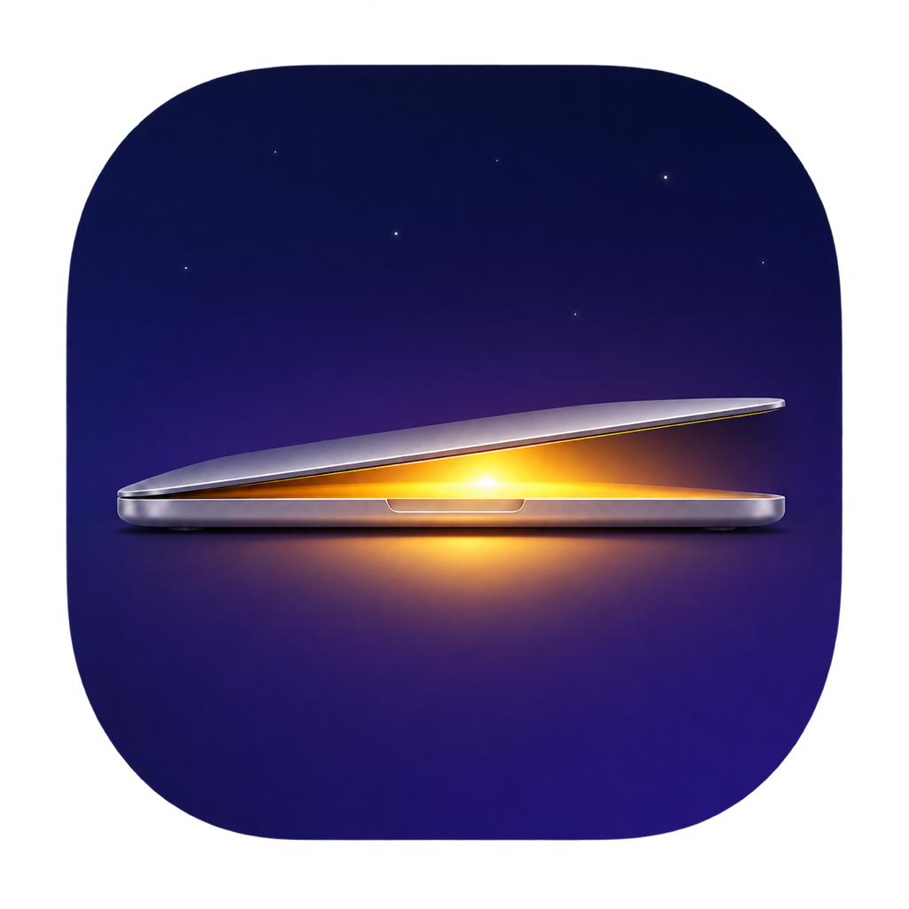

<p align="center">
  
</p>

<h1 align="center">Lidlight</h1>

<p align="center">
  Keep your Mac awake with the lid closed — for 15 minutes, 4 hours, or until you say so.<br>
  A tiny, native menu bar app. No dependencies. ~300 lines of Swift.
</p>

<p align="center">
  <a href="https://github.com/Nikamura/lidlight/releases/latest"></a>
  
  
  <a href="LICENSE"></a>
</p>

---

## Why

Closing a MacBook's lid puts it to sleep — even with `caffeinate`, Amphetamine-style
assertions, or KeepingYouAwake running. The only built-in exception is clamshell mode,
which needs power, an external display **and** an external keyboard/mouse.

The one switch that really works is `pmset -a disablesleep 1`. It's also easy to forget,
leaving a closed laptop running hot in a bag. Lidlight wraps that switch in a timer so it
always turns itself back off.

Handy for: long downloads, builds, backups, renders, SSH sessions, or AI coding agents
that should keep working while you carry the laptop around.

## Features

- ☀️ **One click** from the menu bar: 15 min, 30 min, 1 h, 2 h, 4 h, 8 h, custom, or until turned off
- ⏱ **Countdown** in the menu bar (`☀ 45m`), with **+15 min** / **+1 hour** to extend
- 🔋 **Battery guard** — turns sleep back on when unplugged and at or below 10%
- 🛟 **Fail-safe** — sleep is restored when the timer ends, on Quit, and on next launch after a crash or reboot
- 🔐 **Least privilege** — one admin prompt, ever; grants only `pmset -a disablesleep 0|1`
- 🚀 **Launch at login** toggle
- 🪶 Native AppKit, universal binary, no dependencies, no network access, no telemetry

## Install

1. Download **Lidlight.zip** from the [latest release](https://github.com/Nikamura/lidlight/releases/latest) and unzip it.
2. Move `Lidlight.app` to `/Applications` (or `~/Applications`).
3. The app is ad-hoc signed, not notarized, so clear the quarantine flag once:
   ```sh
   xattr -dr com.apple.quarantine /Applications/Lidlight.app
   ```
4. Open it. A 🌙 appears in the menu bar.

Or build it yourself (needs Xcode Command Line Tools):

```sh
git clone https://github.com/Nikamura/lidlight.git
cd lidlight
./build.sh --install   # → ~/Applications/Lidlight.app
```

## How it works

The first time you turn it on (or off), Lidlight asks for your admin password once and
installs this sudoers rule at `/etc/sudoers.d/lidlight`:

```
<you> ALL=(root) NOPASSWD: /usr/bin/pmset -a disablesleep 0, /usr/bin/pmset -a disablesleep 1
```

The rule is validated with `visudo` before it's installed. After that, the app toggles the
setting with `sudo -n` and never asks again. It cannot run any other command as root.

The end time is saved in user defaults. Every 15 seconds the app checks the clock and the
battery. Because the Mac isn't sleeping, the timer keeps running with the lid closed.

| Event | What happens |
| --- | --- |
| Timer ends | Sleep re-enabled, notification shown |
| Unplugged and battery ≤ 10% | Sleep re-enabled, notification shown |
| You quit Lidlight | Sleep re-enabled |
| App crashed / Mac rebooted mid-timer | Sleep re-enabled on next launch if the time has passed |
| Setting changed in Terminal | Menu bar updates to match |

## ⚠️ Be careful

A closed laptop that isn't sleeping can get hot, especially in a bag or sleeve. Prefer
timers over "until turned off", and keep it somewhere it can breathe.

## Uninstall

```sh
sudo pmset -a disablesleep 0          # make sure sleep is back to normal
sudo rm /etc/sudoers.d/lidlight       # remove the permission rule
rm -rf /Applications/Lidlight.app ~/Applications/Lidlight.app
defaults delete dev.karolis.lidlight
```

## License

[MIT](LICENSE)
